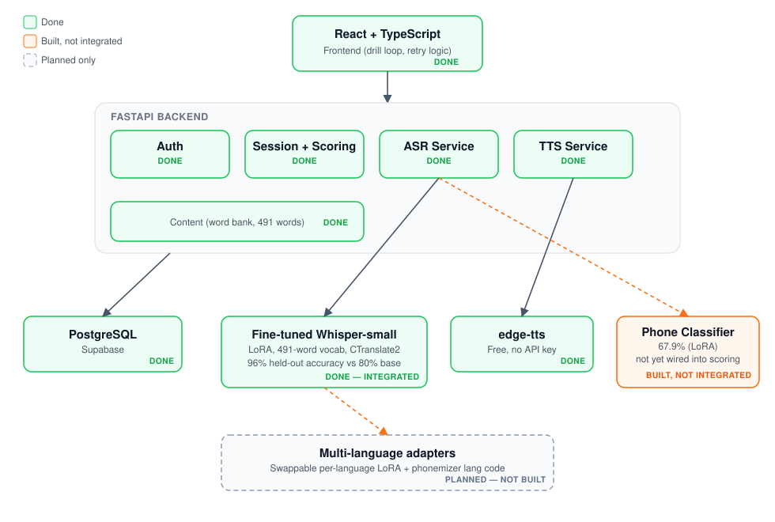
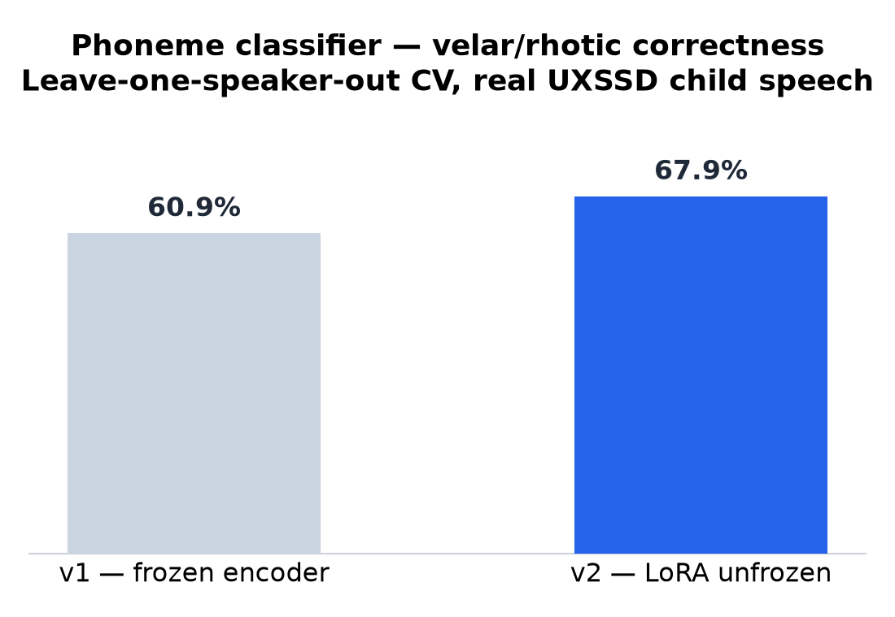
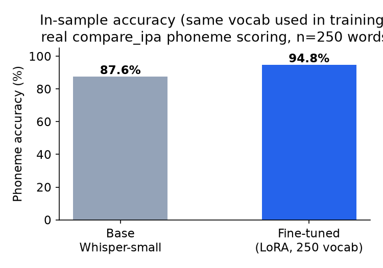
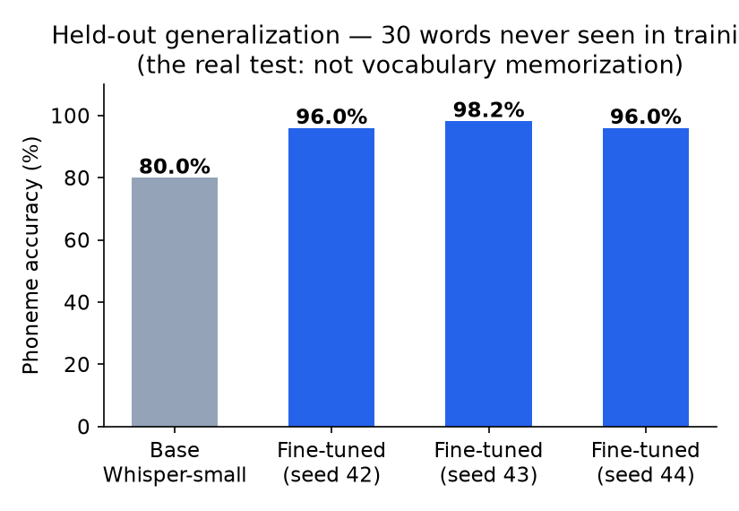
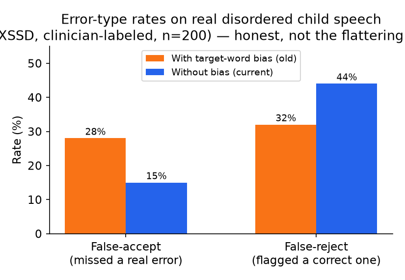

# ArticuPlay


AI-assisted speech-therapy drill app for children with Childhood Apraxia of Speech (CAS).
A child hears a target word (TTS), repeats it, and the app scores the pronunciation at the
phoneme level — substitution, omission, cluster-reduction, syllable-deletion — matching how a
real speech-language pathologist assesses CAS, rather than a simple right/wrong check.

**Status: in active development, not yet publicly deployed.** Backend and frontend are built
and verified end-to-end (register → create child → run a drill session → real speech scored →
retry logic → session complete) with real voice input in a local test environment.

**No child has used the app yet.** All testing so far is on public corpus recordings, synthetic
TTS audio, and the developer's own voice. The disordered-speech test data is children with
*speech sound disorders* (UltraSuite UXSSD), the closest public proxy; no public audio dataset of
children with a confirmed CAS diagnosis exists. A pilot with real children, under ethics
approval, has not started.

The app's screens still use the project's earlier working name, StoryWeaver.

**Language: English only, currently.** The architecture is designed to support more (a
swappable per-language LoRA adapter on a shared multilingual Whisper base, plus a
`phonemizer` language-code swap for IPA scoring) — but no second-language adapter has been
built or trained yet. Don't read "multilingual-ready architecture" as "multilingual today."

## Architecture



Green/solid = shipped and integrated. Dashed gray = designed for, not built (multi-language
adapters).

## Stack

- **Backend**: FastAPI + SQLAlchemy (async) + Alembic + PostgreSQL (Supabase)
- **Frontend**: React 19 + TypeScript + Vite + Tailwind CSS
- **Speech recognition**: self-hosted Whisper (`faster-whisper`), LoRA fine-tuned (see below)
- **Phoneme scoring**: `phonemizer` (espeak-ng backend) for IPA conversion, custom Wagner-Fischer
  edit-distance alignment for error classification
- **TTS**: `edge-tts` (free, no API key)
- Fully self-hosted — zero per-request inference cost.

## Models trained

This isn't a wrapper around a hosted API — the speech-recognition model is genuinely trained,
with an explicit generalization test (not just re-testing on training vocabulary) at every stage.

### Phoneme classifier (`research/phone_classifier/`)
Binary correct/needs-work classifier for two CAS-relevant phone categories (velars, rhotics),
trained on real disordered child speech (UltraSuite UXSSD corpus, leave-one-speaker-out CV).
- v1 — frozen Whisper encoder embeddings + linear head: **60.9%**
- v2 — LoRA-unfrozen encoder (`r=8, alpha=16`): **67.9%**




### Speech-to-text transcriber (`research/uxtd_transcriber/`)
Whisper-small, progressively fine-tuned on UltraSuite UXTD (child speech corpus) plus synthetic
TTS audio of the app's own product vocabulary:

| Stage | What changed | Result |
|---|---|---|
| Full fine-tune | All 243M params updated | Overfit / catastrophic forgetting |
| LoRA (`r=16, alpha=32`, UXTD only) | Adapter-only fine-tune (1.77M trainable params, 0.73%) | Fixed overfitting, but vocabulary mismatch with product words |
| LoRA + sentence augmentation | Added 100 synthetic sentence examples | Fixed sentence-level (Level 5) collapse |
| LoRA + full product vocabulary (250 words) | Added all 250 original product words as synthetic audio | 94.8% on training vocabulary — but untested on unseen words |
| **LoRA + expanded vocabulary (491 words, current)** | Expanded word bank (wider category variety: animals, food, body parts, verbs, emotions, new phrase/sentence structures), retrained | **96.0% phoneme accuracy on a genuinely held-out 30-word set never seen in training, vs 80.0% for stock Whisper** — verified stable across 3 independent training seeds (96.0% / 98.2% / 96.0%, spread 2.2 points). Test audio is synthetic TTS (edge-tts), not child recordings |




### Model version history

Every distinct model/code version this project has produced, in order — #1 is the first,
the highest number is what's live today. Current versions link to their real file in this repo;
retired versions that got edited in place (before this repo's history began) link into
[`archive/`](archive/) so nothing is lost.

| # | Version | Result | Code |
|---|---|---|---|
| 1 | Phone classifier v1 — frozen encoder | 60.9% | [`train_classifier.py`](research/phone_classifier/train_classifier.py) |
| 2 | Phone classifier v2 — LoRA-unfrozen encoder | 67.9% | [`train_classifier_unfrozen.py`](research/phone_classifier/train_classifier_unfrozen.py) |
| 3 | Transcriber — full fine-tune | Overfit / catastrophic forgetting | [`train.py`](research/uxtd_transcriber/train.py) |
| 4 | Transcriber — LoRA, UXTD data only | Fixed overfitting, vocab mismatch remained | [`train_lora.py`](research/uxtd_transcriber/train_lora.py) |
| 5 | Transcriber — LoRA + sentence augmentation | Fixed Level 5 (sentence) collapse | [`train_lora_augmented.py`](research/uxtd_transcriber/train_lora_augmented.py) |
| 6 | Transcriber — LoRA + 250-word vocab | 94.8% in-sample | [`archive/train_lora_fullvocab_250vocab.py`](archive/train_lora_fullvocab_250vocab.py) |
| 7 | Held-out eval of #6 vs base, n=50 | 82.7% → 95.2% *(superseded)* | [`archive/evaluate_new_words_heldout_50word_v2.py`](archive/evaluate_new_words_heldout_50word_v2.py) |
| 8 | Production ASRService v1 — base Whisper + target-word bias | false-accept 28% / false-reject 32% | [`archive/asr_service_v1_base_biased.py`](archive/asr_service_v1_base_biased.py) |
| 9 | Transcriber — LoRA + 491-word vocab | **80.0% → 96.0%, n=30 (synthetic TTS audio), current** — stable across seeds (96.0/98.2/96.0); Nov 2026 rebuild: 86.7% → 96.7% | [`train_lora_fullvocab.py`](research/uxtd_transcriber/train_lora_fullvocab.py) + [`evaluate_new_words_heldout.py`](research/uxtd_transcriber/evaluate_new_words_heldout.py) |
| 10 | Production ASRService v2 — #9's model, bias removed | false-accept 15% / false-reject 44% | "before" side of [commit 2c1ab46](https://github.com/roshnrf/ArticuPlay/commit/2c1ab460aa4ba69266f6f41ec10e16207229dc4c) |
| 11 | Phone classifier — final deployable checkpoint (trained on all 864 real examples, no CV holdout) | Ready to integrate | [`train_classifier_final.py`](research/phone_classifier/train_classifier_final.py) |
| 12 | Production ASRService v3 — #10 + phone classifier gate | **false-accept 3% / false-reject 46%, current** | [`asr_service.py`](backend/app/services/asr_service.py) + [`phone_classifier_service.py`](backend/app/services/phone_classifier_service.py) |

**Going forward**: any time a script gets edited in place to produce a new result rather than
saved as a new file, the pre-edit version goes in `archive/` before the edit — so the code
behind every number stays inspectable, not just the latest one.

## Honest results (not just the headline number)

Rigor checks run against the current model, including the uncomfortable ones:

- **Generalization**: 96.0% vs base Whisper's 80.0%, on 30 words that did not exist when the
  model was trained (not a re-test on training data). The test audio is synthetic TTS
  (edge-tts), not recordings of children saying those words.
- **Reproducibility**: stable across seeds 42/43/44 (96.0% / 98.2% / 96.0%). Rebuilt from this
  repo in November 2026 (see below): 96.7% vs 86.7% for seed 42.
- **Real child speech**: on UXTD's held-out test set (typically developing children never seen
  in training), word error rate 0.58 vs 2.19 for stock Whisper, so adding the synthetic product
  vocabulary did not cost accuracy on real children's voices.
- **Latency**: ~2s CPU inference, ~3.0-3.5s end-to-end through the real API (webm decode + request
  overhead) — at the edge of the 3s/item budget, no headroom.
- **Real disordered-speech error detection** (the model's actual clinical job, tested on the
  UltraSuite UXSSD corpus of children with speech sound disorders, scored by speech therapists;
  not a confirmed CAS population), measured through the full local scoring pipeline, not just
  the raw model. These figures are from the July 2026 models and have not yet been re-measured
  on the November rebuild:

  | Stage | False-accept | False-reject |
  |---|---|---|
  | Target-word decoding bias (original) | 28% | 32% |
  | Unbiased decoding | 15% | 44% |
  | **+ Phoneme classifier gate (current)** | **3%** | 46% |

  Transcript-based scoring alone can't catch a real articulation error when the transcript
  still reads as the right word. Routing through the phoneme classifier as a one-directional
  gate (only ever downgrades a pass, never upgrades a fail) closed most of that gap — false-accept
  dropped from 28% to 3%. False-reject did not improve: about half of correct attempts are still
  rejected (46%). Closing the more dangerous direction (praising a real error) came first; the
  false-reject rate is now the main open problem and must come down before any child uses the
  app.




## Difficulties faced, from the start to now

Not a smooth build — real problems hit at every layer, most requiring root-cause work rather
than a quick patch. Resolved unless marked otherwise.

**Environment & tooling**
- Windows Smart App Control blocked compiled Python wheels (phonemizer's `regex` dependency) —
  moved development to WSL2 rather than fight the OS policy per-package.
- RTX 5070 Ti (Blackwell) needed `torch==2.13.0`; `torch.cuda.is_available()` returning `True`
  wasn't enough evidence — a real matmul silently lacked kernel support on the pinned version.
  Lesson: always test a real op on new hardware, not just the availability flag.
- `peft` + `torch.distributed.tensor` lazy-import conflict — hit **three separate times** across
  different scripts (transcriber training, phone classifier training, phone classifier
  production service) before the pattern was recognized as systemic rather than one-off.
- Manual `nohup`/`disown` didn't reliably keep background processes alive through this WSL
  bridge; switched to the tooling's own background-process tracking instead.
- Converting the fine-tuned model to CTranslate2 format needed a newer `transformers` than the
  training venv had — used an isolated venv rather than risk breaking the training setup.

**Model training & data quality**
- UXTD corpus contamination (session-administration speech mixed into training labels) — found
  in two rounds; a first regex filter only caught 37% of it, a full manual audit of the label
  vocabulary found the real number was 66%, fixed with an exact-match denylist.
- Level 5 (sentence-level) accuracy collapsed after the contamination fix — diagnosed as missing
  grammatical-sentence-structure exposure, not an audio-quality issue, fixed via synthetic
  sentence augmentation.
- Repetition-loop / premature-truncation failures ("cone" → "cone, cone, cone...") — beam search
  fixed most of these at zero retraining cost; a base-model "98.8%" accuracy figure turned out to
  be inflated by exactly this kind of garbage getting substring-matched as correct.
- The phone classifier's reported 67.9% came from 8 cross-validation folds that never saved a
  single deployable checkpoint — had to retrain one final model on all real examples before it
  could actually be integrated.

**Evaluation rigor**
- Every early "beats base Whisper" claim was tested on the same vocabulary the model trained
  on — not a real generalization test. Rebuilding a genuine held-out test took two attempts: a
  first 50-word holdout was judged too small/arbitrary, replaced with a larger, wider-variety
  vocabulary expansion (491 words) plus a fresh, never-trained 30-word test set.
- Code for two of those earlier stages had been edited in place before this repo's git history
  began, so the code behind an early reported number became unrecoverable from `git log` —
  manually reconstructed and preserved in [`archive/`](archive/).
- Tried lowering the pass-threshold to fix false-reject — empirically found it's a wash (trades
  false-reject for false-accept roughly 1-for-1, current threshold is actually near-optimal).
  **Still open**: false-reject sits at 46%, root cause understood (unbiased ASR mishears real
  correct speech more often) but not yet fixed.

**Security** (found via a full audit, not a diff review — see commit history for verification)
- `/session/*` endpoints had **zero authentication** — any request with a `child_id` or
  `session_id` UUID could read a child's therapy history or write fabricated scores into it, no
  login required. Root cause: written before the auth pattern was established elsewhere in the
  codebase and never retrofitted. Fixed by mirroring the correct pattern already used for
  children — verified live (unauthenticated → 401, cross-user access → 404, legit flow
  unaffected).
- Supabase flagged `rls_disabled_in_public` + `sensitive_columns_exposed` as critical — every
  public-schema table (including a users table with password hashes) was reachable through
  Supabase's auto-generated API, independent of anything the backend's own auth did, because
  this project only ever used a direct Postgres connection and nobody had visited the dashboard
  to lock down the auto-API. Fixed by enabling Row-Level Security on all tables (confirmed zero
  effect on the app itself — its DB role is a superuser, which bypasses RLS by design). Missed
  `alembic_version` (not an app model, so absent from the first pass) on the first attempt —
  caught by Supabase's scanner and fixed in a follow-up migration.

## Known open items

- Remaining 3% false-accept and the flat 46% false-reject on real disordered speech — the
  phoneme classifier itself is only ~68% accurate, a ceiling on how far this approach alone gets
- Real webm/opus browser audio confirmed working end-to-end, but not yet stress-tested at scale
- CPU latency (~3s, no headroom) — needs webm-decode optimization or GPU hosting for a real pilot
- Multi-language support — architecture supports it (swappable per-language LoRA adapter + a
  `phonemizer` language-code swap), not yet built for a second language

## Rebuild from this repo (November 2026)

In November 2026 the original development machine's project folder, WSL install, trained models
and corpus data were lost; this GitHub repo was the only surviving copy. Everything was rebuilt
from it: fresh WSL environment, data re-pulled from UltraSuite, the identical training split
(1243 / 136 / 188 plus 491 synthetic clips), and the transcriber retrained with seed 42 (about
5 minutes on an RTX 5070 Ti).

| | July 2026 | November 2026 rebuild |
|---|---|---|
| Held-out 30 words, ours vs stock Whisper | 96.0% vs 80.0% | 96.7% vs 86.7% |
| Words where the model loops ("moth moth moth…") | — | ours 1, stock 5 |

Stock Whisper scores differently because the test audio is regenerated with TTS on every run and
`edge-tts` changed version in between. Seeds 43/44 and the false-accept/false-reject pipeline
numbers have not been re-run on the rebuilt models yet. Fixes needed for the rebuild (dependency
pins, a double-count bug in the augmentation script, repo-relative paths) are in the commit
history.

## Running it locally

Developed on WSL2 Ubuntu with Python 3.12 and Node 24. Trained model weights are not in this repo
(see below), so a fresh clone needs to train the transcriber once before the app will start.

**1. System packages**
```bash
sudo apt install espeak-ng ffmpeg postgresql
```

**2. Backend**
```bash
cd backend
python3.12 -m venv .venv && source .venv/bin/activate
pip install -r requirements.txt
cp .env.example .env          # fill in DATABASE_URL, JWT_SECRET, ALLOWED_ORIGINS, etc.
alembic upgrade head
python -m scripts.seed_word_content      # 250 words
python -m scripts.seed_word_content_v2   # +50
python -m scripts.seed_word_content_v3   # +191, 491 total
uvicorn app.main:app --port 8000
```
Works against Supabase or plain PostgreSQL. On plain PostgreSQL, the row-level-security
migrations expect Supabase's roles to exist; create them once first:
`CREATE ROLE anon NOLOGIN; CREATE ROLE authenticated NOLOGIN; CREATE ROLE service_role NOLOGIN;`

**3. Frontend**
```bash
cd frontend
cp .env.example .env          # VITE_API_BASE_URL=http://localhost:8000/api/v1
npm install
npm run dev                   # http://localhost:5173
```

**4. Models**

The app loads two models from `backend/ml_models/` (gitignored):

- `phone_classifier_v1/`: copy from
  [`research/phone_classifier/phone_classifier_final/`](research/phone_classifier/phone_classifier_final/),
  which is committed.
- `storyweaver_whisper_v1/`: the transcriber, trained from the scripts in
  [`research/uxtd_transcriber/`](research/uxtd_transcriber/). With the backend running (the
  augmentation scripts call its TTS endpoint) and a CUDA GPU:
  ```bash
  cd research/uxtd_transcriber
  bash pull_data.sh                     # UXTD audio + prompts from UltraSuite (~1.2 GB)
  python build_dataset.py               # filters session-instruction labels, speaker-disjoint split
  python augment_with_full_vocab.py     # synthetic audio, original 250 words
  python augment_v2v3.py                # synthetic audio, 241 expansion words
  python train_lora_fullvocab.py --seed 42
  python evaluate_new_words_heldout.py  # 30 held-out words vs stock Whisper
  python merge_lora_for_deploy.py       # LoRA adapter -> merged Hugging Face model
  ct2-transformers-converter --model uxtd_whisper_small_merged \
      --output_dir ../../backend/ml_models/storyweaver_whisper_v1 \
      --copy_files preprocessor_config.json
  ```
  The CTranslate2 converter needs a newer `transformers` than the training environment pins;
  run it from a separate virtual environment with `ctranslate2` installed.

## License

Code in this repository is released under the [MIT License](LICENSE).

The training data is not covered by that licence. Fine-tuning used the UltraSuite corpus (UXTD,
UXSSD, Cleft — CC BY-NC 4.0, non-commercial). The corpus itself is not redistributed in this
repo; only the training/evaluation scripts are. Model weights trained on it carry the same
non-commercial restriction, and commercial use would need written permission from the UltraSuite
maintainers.
